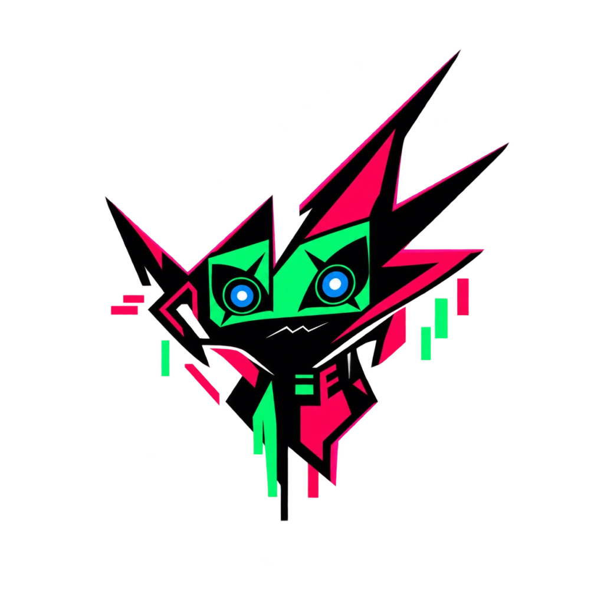

<p align="center">
  
</p>

<h1 align="center">Capri</h1>

<p align="center">A remote controller for coding harnesses running on your own machines.</p>

Capri lets you resume agent sessions, read model replies, answer approval prompts, send input, and inspect remote terminals without moving the work away from the machine where it runs. The controller is designed as a shared platform with multiple clients and one machine-side runtime.

## Clients

Capri is not tied to one device or interface. Each client talks to the same authenticated Capri Runtime over the user’s private network.

- **Even G2:** a compact glasses client for live status, readable replies, approvals, and quick input. The current implementation lives in [`Even_G2/`](./Even_G2).
- **Android and iOS:** planned mobile clients for full session control, setup, terminal access, speech input, and approvals.
- **Web:** planned dashboard for managing machines, harnesses, sessions, runtime settings, and live conversations from a browser.

## Runtime

The machine-side `capri-runtime` service discovers and controls coding harnesses already installed on a Linux or macOS machine. It starts or resumes sessions in their existing working directories and exposes an authenticated API over Tailscale.

Capri keeps agent execution and credentials on the target machine. Tailscale provides the private route, and the runtime token authenticates each paired client.

Supported harnesses depend on what is installed on the target machine, including Claude Code, Codex, OpenCode, Ghost, CodeWhale, DeepSeek Harness, Kimi Code, Gemini CLI, Cline, and compatible future harness adapters.

## Quick start

Install the runtime on the machine that owns the coding-agent sessions:

```sh
curl -fsSL https://raw.githubusercontent.com/ARCANGEL0/Capri/main/runtime/setup_install.sh | bash
```

The installer:

- creates the `capri-runtime` service;
- supports Linux with `systemd` and macOS with `launchd`;
- keeps the runtime bound to localhost;
- configures Tailscale Serve when the Tailscale CLI is available; and
- prints the endpoint and token needed to pair a Capri client.

The installer is also available at [`runtime/setup_install.sh`](./runtime/setup_install.sh).

After installation, add the printed endpoint and token in the client’s setup screen. Keep the token private and rotate it by running the installer again when needed.

## Project layout

```text
Even_G2/       Even Realities G2 client and HUD assets
runtime/       Linux/macOS Capri Runtime installer and service templates
```

The repository is intentionally organized around the shared runtime and separate clients. New clients should reuse the runtime API instead of creating a new machine connector.

## Development

Build the current Even G2 client with:

```sh
cd Even_G2
npm install
npm run dev
npm run build
npm run pack
```

`npm run pack` creates an Even Hub package for the G2 client. Its manifest is [`Even_G2/app.json`](./Even_G2/app.json). The package identifier is `com.arcxlo.capri`.

## Roadmap

- [ ] Add Capri client to the Even G2 smart glasses
- [ ] Build Capri client for Android & iOS
- [ ] Make web dashboard
- [ ] Add more coding-harness adapters
- [ ] Add shared client authentication and device management
